<p align="center">
  
</p>

<h1 align="center">Jellio</h1>

<p align="center">
  A custom web client plugin for Jellyfin, styled after modern streaming apps<br>
  and built around remote/debrid sources resolved through Gelato.
</p>

## Features

- **Home & discovery**: Continue Watching, Next Up, weighted personal Top Picks,
  Because You Watched, Studio Hubs (Netflix, Disney+, Max, Apple TV+, Prime Video,
  Crunchyroll, and more), infinite genre rows, a hero carousel, a Coming Soon
  calendar, seasonal theming, and customizable row layouts synced across devices.
- **Search & detail pages**: typo-tolerant fuzzy search with query suggestions and
  similar results, rich TMDB actor and crew pages with biographies and
  filmographies, multi-edition recognition (Theatrical, Director's Cut, Extended,
  Noir, IMAX), watchlists, and custom list membership.
- **Custom video player & stream intelligence**: proactive stream warmup with
  `Ready` badges, automatic failover and placeholder detection, real-duration
  learning for Gelato-resolved sources (so watched-state crediting and Continue
  Watching reflect the true file runtime rather than broadcast metadata),
  multi-tier Skip Intro and Skip Credits (native segments, Intro Skipper,
  TheIntroDB, SkipMe.db, IntroDB, and built-in Chromaprint audio fingerprinting),
  trickplay scrubbing, subtitle sync, dialogue boost, sleep timer,
  Picture-in-Picture, and local network casting to Jellio TV.
- **Books, Manga & Audiobooks**: dedicated shelves with custom categories, a
  built-in EPUB and PDF reader (themes, typography, search, 5-color highlights,
  and notes), a comic and manga reader (CBZ/CBR/CB7 and live Suwayomi streaming
  with 5 reading modes, scanlator filters, and Mihon backup import), inline
  Wiktionary/DeepL lookup with spaced-repetition vocabulary flashcards, Chaptarr
  book discovery and requests, and a full audiobook player with chapter markers
  and a persistent docked mini-player.
- **Offline downloads**: Service Worker offline cache and download manager for
  movies, episodes, books, manga chapters, and audiobooks with selectable quality
  tiers (including HEVC) and offline progress sync.
- **Live TV**: live channel browser and player with category filters, channel
  health monitoring, automatic stream recovery, and custom stream pairing.
- **Social, Group Watch & Ani-Sync**: watch parties over Jellyfin's native
  SyncPlay with invites, in-player chat, join sync, and voting; Friends and shared
  watchlists (add titles directly to friends' watchlists with avatar badges);
  profiles with achievement badges, binge streaks, activity feed, and privacy
  controls; per-user two-way Ani-Sync (AniList, MyAnimeList, Shikimori, Simkl);
  admin broadcast notifications; account switching; and much more.
- **7 languages**: full localization in English, German, Spanish, French, Italian,
  Polish, and Portuguese.

## Companion Apps

- [Jellio TV](https://github.com/NoahSKipp/Jellio-TV) - Android TV, Google TV, and Fire TV client
- [Jellio for Android](https://github.com/NoahSKipp/Jellio-Android) - Native Android phone and tablet client
- [Jellio for Samsung Tizen](https://github.com/NoahSKipp/Jellio-Tizen) - Samsung Smart TV client (Tizen 4.0+)
- [Jellio for macOS](https://github.com/NoahSKipp/Jellio-macOS) - Native Apple Silicon macOS desktop app

## Installation

Jellio is distributed as a Jellyfin plugin repository.

1. In Jellyfin, go to **Dashboard → Plugins → Repositories**
2. Add a repository with this URL:
   ```
   https://noahskipp.github.io/Jellio/repository.json
   ```
3. Go to **Catalog**, find **Jellio** under Jellio's repository, and
   install it
4. Restart Jellyfin

Updates are then picked up the same way as any other plugin: a new
version appears under **Catalog** once published, and updating in place
keeps your configuration, achievements, and other plugin data intact.

## Requirements

- Jellyfin server `10.11.11`
- A library backed by [Gelato](https://github.com/lostb1t/Gelato) (or a
  similarly remote-resolved source) - Jellio assumes no local media

## Credits

- UI/UX inspired by [Nuvio](https://github.com/NuvioMedia/NuvioTV) and
  [Harbor](https://github.com/harborstremio/harbor)
- Seasonal theming based on
  [CodeDevMLH/Jellyfin-Seasonals](https://github.com/CodeDevMLH/Jellyfin-Seasonals)
- Sleep timer based on
  [jon4hz/jellyfin-plugin-jellysleep](https://github.com/jon4hz/jellyfin-plugin-jellysleep)
- In-player episode preview based on
  [Namo2/InPlayerEpisodePreview](https://github.com/Namo2/InPlayerEpisodePreview)
- Achievement badges based on
  [ZL154/AchievementBadges_for_Jellyfin](https://github.com/ZL154/AchievementBadges_for_Jellyfin)
- Ani-Sync inspired by and adapted from
  [vosmiic/jellyfin-ani-sync](https://github.com/vosmiic/jellyfin-ani-sync)

## Disclaimer

This is a personal project built for my own Jellyfin server, developed
with AI-assisted coding and manual review. Use at your own discretion.

## License

[GPL-3.0](LICENSE)
